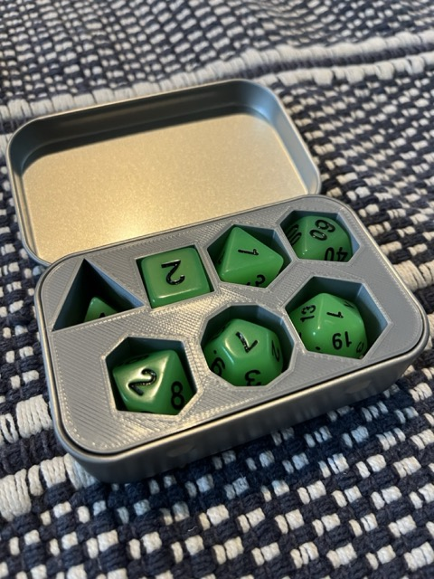
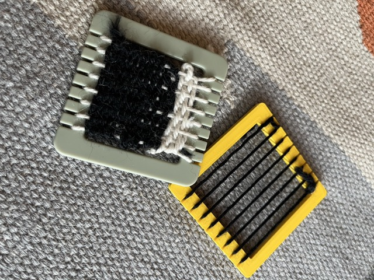

# STL / OpenSCAD Stuff

Uploaded to my profile
https://www.printables.com/@ifuporg_306506

## Dice Box

A remix of OpenSCAD dice box by Xavier Faraudo to fit dice found on Alixpress that were too large for the original.

## Mini Loom

I needed a second loom similar to the loom my other kid had. This is about 3" (75mm) square.

